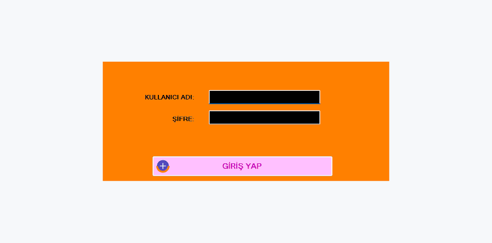
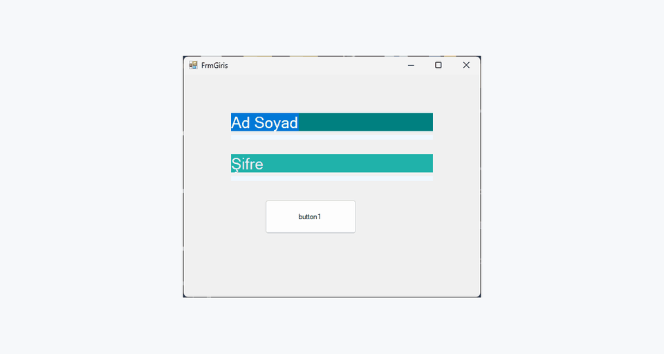
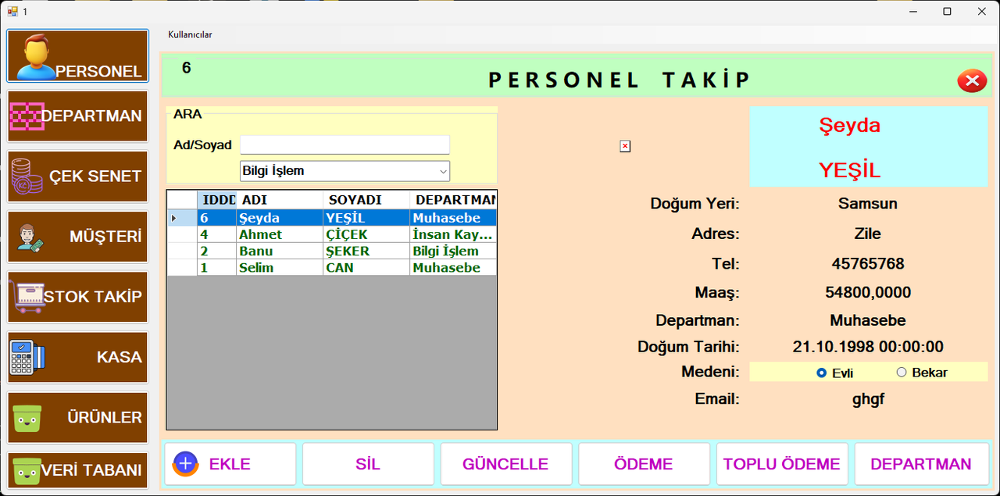
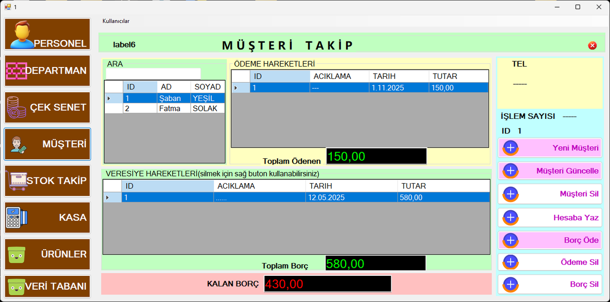
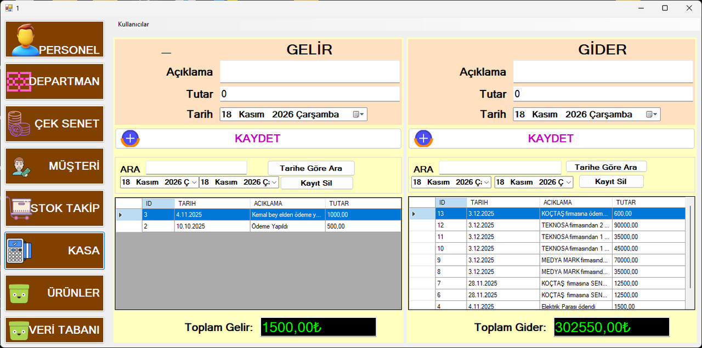

# 🏢 İş Takip Otomasyonu


Küçük bir işletmenin **personel, departman, müşteri (veresiye), tedarikçi firma, stok, kasa ve çek/senet** işlemlerini tek uygulamada yöneten masaüstü otomasyonu. Kullanıcı bazlı modül yetkilendirmesi ve veritabanı yedekleme ekranı da vardır.

Depoda projenin **iki sürümü** bulunur:

| Klasör | Açıklama | Veritabanı |
| --- | --- | --- |
| [`IsTakip-Projemiz`](IsTakip-Projemiz) | Son sürüm: Guna UI2 arayüz, menü tabanlı ana ekran | `DBIstakik` |
| [`IsTakip-A-Grubu`](IsTakip-A-Grubu) | Ders kapsamında geliştirilen A grubu sürümü: toplu maaş ödemesi, hesaba yazma | `DbIstakip25_A` |

---

## 🎬 Demo



**A Grubu sürümü:** giriş ve modüller (personel, çek/senet, müşteri, stok, kasa, ürünler).



**Projemiz sürümü:** giriş ve modüller.

| Personel takip | Müşteri takip: ödeme ve veresiye hareketleri | Kasa: gelir/gider |
| --- | --- | --- |
|  |  |  |

> Görüntüler, depodaki kurulum script'iyle kurulan örnek veritabanı üzerinde uygulama çalıştırılarak alınmıştır.


## 🚀 Özellikler

- **Giriş ve yetkilendirme:** Kullanıcı adı ve şifre ile giriş. Her kullanıcı için hangi modülleri (Personel, Departman, Çek/Senet, Müşteri, Stok, Kasa, Ürünler, Veri Tabanı) kullanabileceği ayrı ayrı belirlenir.
- **Personel:** Ekleme (fotoğraflı), güncelleme, silme, departmana göre filtreleme, ad/soyad ile arama
- **Personel ödemeleri:** Tekil ödeme; A grubu sürümünde toplu ödeme (maaşın %10'u, %20'si, tam maaş veya sabit tutar)
- **Departman yönetimi**
- **Müşteri (veresiye) takibi:** Hesaba yazma, borç ödeme, ödeme hareketleri, toplam/kalan borç
- **Firmadan ürün alımı:** Nakit, çek veya senet ile alım; firmaya ödeme; kalan borç
- **Stok takibi**
- **Kasa:** Gelir/gider kaydı, tarihe göre arama, toplamlar
- **Çek/senet takibi:** Bugün ve yarın ödenecekler, ödenen/ödenmeyen filtreleri, ödendi işaretleme
- **Veri tabanı işlemleri:** SQL Server Management Objects (SMO) ile **yedek alma** ve **yedekten geri yükleme**

## 🗄️ Veritabanı

14 tablo: kullanıcı, personel, personel ödemeleri, departman, müşteri, müşteri borç/ödeme, firma, firma hareketleri/ödemeleri, ürün, kategori, kasa, çek/senet.

---

## ⚙️ Kurulum

**Gereksinimler:** Visual Studio 2022/2026 (*.NET masaüstü geliştirme*) · SQL Server (Express yeterli) · SQL Server Management Studio (SSMS) 22

1. **İndirin**
   ```bash
   git clone https://github.com/GencayCeliker/Is-Takip-Otomasyonu.git
   ```
2. **Veritabanını kurun (SSMS 22):** Çalıştıracağınız sürümün `Veri Tabanı` klasöründeki script'i açıp **Execute (F5)**'e basın:
   - `IsTakip-Projemiz/Veri Tabanı/DBIstakik.sql`
   - `IsTakip-A-Grubu/Veri Tabanı/DbIstakip25_A.sql`
3. **Bağlantıyı kontrol edin:** Her iki sürümde de `App.config` içinde `data source=.\SQLEXPRESS` kullanılır. Varsayılan SQL Server örneği kullanıyorsanız `data source=.` yapın. Yedekleme ekranındaki sunucu adı da `.\SQLEXPRESS`'tir.
4. **Çalıştırın:** İlgili `.sln` dosyasını açın (`IsTakip-Projemiz/Proje/Proje.sln` veya `IsTakip-A-Grubu/IsTakipOtomasyon_A/IsTakipOtomasyon_A.sln`). NuGet paketleri otomatik yüklenir; **F5** ile başlatın.

**Demo giriş (iki sürüm):** Kullanıcı adı `ik`, şifre `61` (tüm modüllere yetkili)

> Örnek verilerdeki TC Kimlik ve telefon numaraları gerçek değildir. Yedekten geri yükleme özelliği, SQL Server servis hesabının erişebildiği bir klasördeki `.bak` dosyasıyla çalışır.

## 📄 Lisans

Bu proje [MIT](LICENSE) lisansı altında sunulmuştur.
